# Setup98

**Setup98 makes single-file Windows 98 installers.** Describe your program in a small INI file (the *manifest*), run
`pack98` on it, and you get one `mygame-1.0-setup.exe`: a classic Win98 wizard, an uninstaller in Add/Remove
Programs, Start menu shortcuts, upgrades that keep the user's settings, and a silent mode for scripts. You write no
installer code and recompile nothing. `pack98` runs on Windows 95/98/NT and on macOS or Linux, and every host writes
byte-identical setups, so you can build your program with Visual C++ 6.0 (or any compiler) and package it on a
modern machine. It is all its own code, compressor included, in portable C++98.

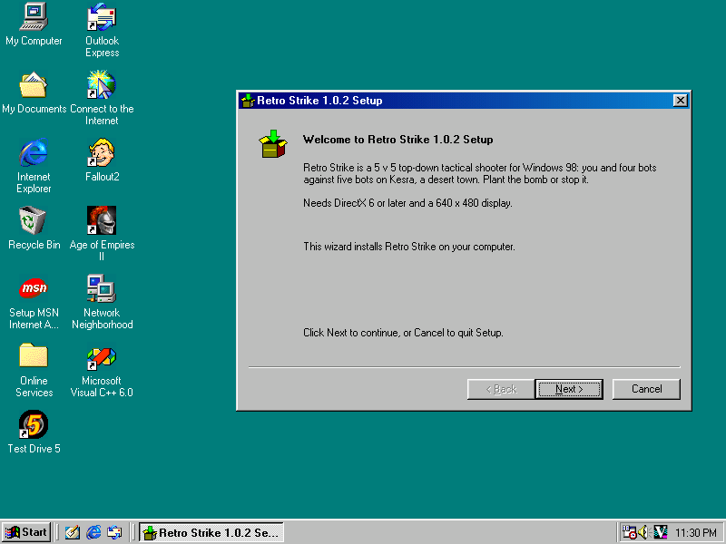

```
manifest.ini + your files --pack98--> setup98.exe + [manifest | compressed files | trailer] = mygame-1.0-setup.exe
```

## Features

- **Win98 wizard**: Welcome, License (optionally "I accept"), Folder and options, File types, Installing, Finish
  ("Start now", "View the readme").
- **Uninstaller** registered in Add/Remove Programs. It asks before it deletes the user's saves and settings, and
  leaves files it didn't install alone.
- **Upgrade, repair and downgrade detection** by version number, with release-candidate labels
  ("Upgrade Retro Strike 1.0.2 RC2 -> 1.0.2"). Program files are replaced; default settings (`Keep=`) and data the
  program writes (`UserData=`) survive.
- **Silent mode** (`/S`, `/D=folder`, `/UNINSTALL /S /PURGE`) with meaningful exit codes.
- **Shortcuts**: a Start menu group, desktop shortcuts, arguments (`-window`), descriptions, icons.
- **File types** done carefully: per-extension ProgIDs that keep Explorer's type names, Print and the New menu,
  an `edit` verb for scripts, an "Open with" context menu entry, and an exact restore on uninstall.
- **Safety**: requirements check (DirectX version, Windows version), disk-space check, "program is running" check
  (window class or title, exe in use), CRC check of every file before anything is replaced, files in use replaced
  at the next restart through `WININIT.INI` with their long names restored, and a log of every step.
- **Small**: the stub is 116 KB; LZ77 + Huffman compression with delta filters for 24-bit BMPs and 16-bit WAVs packs
  a typical game to about a third (better than `gzip -9`).
- **Strict manifest checking**: unknown keys, bad values and missing files stop `pack98` with the manifest line.
- **Your own icon**: one `nmake` line builds a branded stub.

## Screenshots

Retro Strike's installer, made from [`examples/retrostrike.ini`](examples/retrostrike.ini), on Windows 98 SE
(800 x 600):

| | |
|---|---|
| 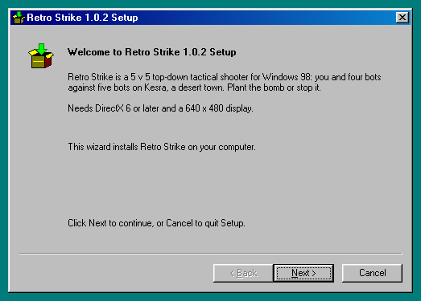 | 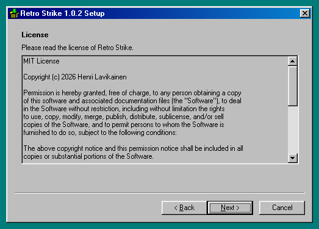 |
| **Welcome**: name, version and your description | **License**: shown, optionally with "I accept" |
| 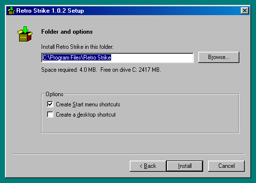 | 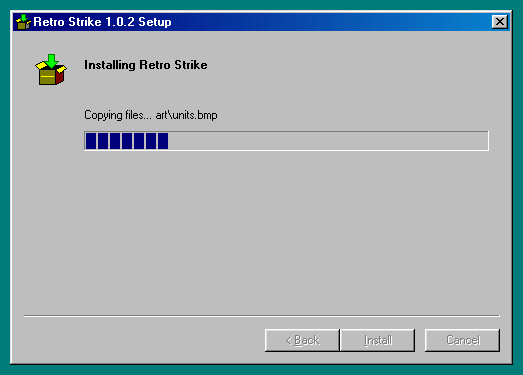 |
| **Folder and options**: space check, shortcut choices | **Installing** |
| 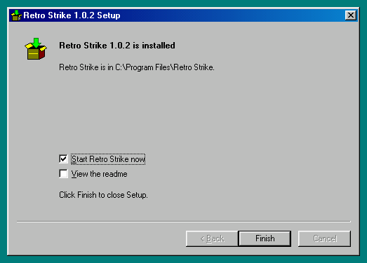 | 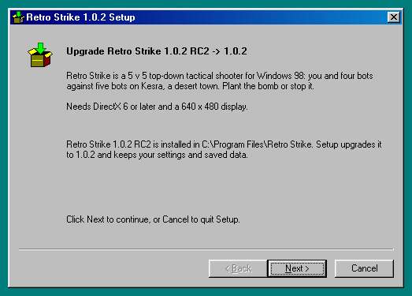 |
| **Finish**: start the program, view the readme | **Upgrade** from a release candidate |
| 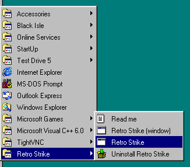 | 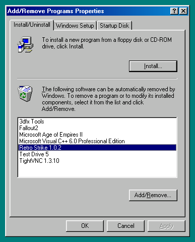 |
| **Start menu** group with arguments and an uninstall link | **Add/Remove Programs** entry |

| |
|---|
| 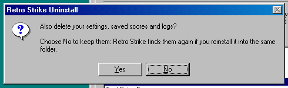 |
| **Uninstall** asks before deleting what the program wrote (`UserData=`); the default is No |

| | |
|---|---|
| 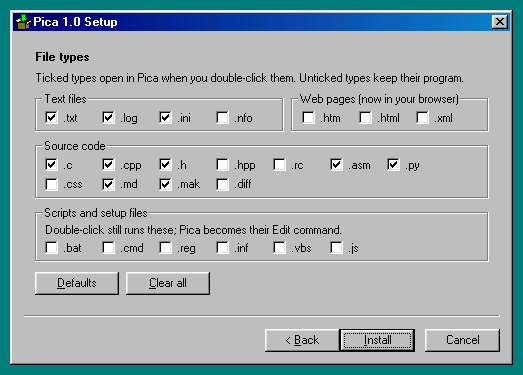 | 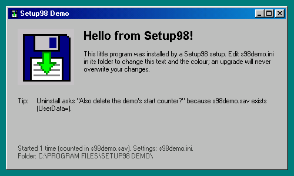 |
| **File types** page of the [Pica](https://github.com/HenriVSL/pica-editor) editor's setup ([`examples/pica.ini`](examples/pica.ini)) | The self-contained **demo** ([`examples/demo`](examples/demo)) after installing |

---

## Quick start

You need the kit: clone this repository, or download `setup98-<version>.zip` from the releases page (the Win98
binaries and the examples).

### 1. Write a manifest

Put it next to your release folder, e.g. `mygame/dist/mygame-setup.ini`. Paths in it are relative to the manifest's
own folder.

```ini
[Product]
Id=MyGame
Name=My Game
Version=1.0
MainExe=mygame.exe

[Files]
Source=../release/MyGame
File=mygame.exe
File=README.TXT
File=art\*.bmp
File=sfx\*.wav
Keep=mygame.ini
UserData=*.sav

[Pack]
OutFile=../release/mygame-1.0-setup.exe
```

That's a complete manifest. `Id` is the registry name (never change it between versions); `Version=from:mygame.exe`
reads the exe's version resource instead. `Source` is the folder that holds the files. `Keep` files are default
settings, installed only if missing. `UserData` files are written by the program and are never shipped; the
uninstaller asks before it deletes them. A Start menu shortcut, the uninstaller, the folder
`C:\Program Files\My Game` and the log come by default. Comments go on their own lines (`;` or `#`).

### 2. Pack it

On **macOS or Linux** (needs `make` and a C++ compiler; the Win98 stub ships prebuilt in `bin/`):

```sh
make                                   # builds bin/pack98 (2 seconds)
bin/pack98 -check mygame-setup.ini     # validate and list the files; writes nothing
bin/pack98 mygame-setup.ini            # writes the setup
```
`tools/pack98 <manifest>` does the same and builds `bin/pack98` first when needed, handy in release scripts.

On **Windows 95/98/NT** (MS-DOS Prompt or `cmd`):

```bat
C:\SETUP98\BIN\PACK98 -check C:\MYGAME\DIST\MYGAME-SETUP.INI
C:\SETUP98\BIN\PACK98 C:\MYGAME\DIST\MYGAME-SETUP.INI
```

Errors name the manifest line, e.g. `pack98: mygame-setup.ini: line 12: MainExe x.exe is not one of the packed files`.

### 3. Test it silently

On the Win98 machine (real or emulated):

```bat
mygame-1.0-setup.exe /S
type C:\WINDOWS\TEMP\MYGAMSET.LOG
dir /s "C:\Program Files\My Game"
"C:\Program Files\My Game\uninst.exe" /S /PURGE
```
`/S` returns exit code 0 on success (see [Switches and exit codes](#switches-and-exit-codes)). The log is
`%TEMP%\<first 5 letters of Id>SET.LOG`. `uninst.exe /S /PURGE` removes everything, including `UserData`. Then run
the setup without `/S` to see the wizard. The [testing checklist](#testing-checklist) has the thorough version.

---

## Examples

| Manifest | What it shows | Packs from this repository? |
|---|---|---|
| [`examples/demo.ini`](examples/demo.ini) | The **self-contained example**: a tiny Win32 program ([`examples/demo`](examples/demo), source and a VC6-built exe) with a data folder, a default ini (`Keep`), a start counter it writes (`UserData`), Start menu shortcuts with arguments, a license page and a file type (`.greet`) | **yes** |
| [`examples/hello.ini`](examples/hello.ini) | The smallest useful manifest (one exe); a template to copy | **yes** |
| [`examples/retrostrike.ini`](examples/retrostrike.ini) | Real-world: [Retro Strike](https://github.com/HenriVSL/retro-strike), a DirectX game: DirectX requirement, running check, readme, license, shortcuts with `-window` | needs the game's release folder at `../sandline/release/RetroStrike` |
| [`examples/pica.ini`](examples/pica.ini) | Real-world: [Pica](https://github.com/HenriVSL/pica-editor), a text editor: file types, "Open with" menu, settings in several places, `Generated=` files, takeover of Pica 1.0's own installer | needs Pica's release folder at `../editor/release/Pica-1.0` |

Try the demo:

```sh
make && bin/pack98 examples/demo.ini          # macOS / Linux
bin\pack98 examples\demo.ini                  # Windows
```
The setup is written to `out/s98demo-1.0-setup.exe` (140,440 bytes). The real-world manifests point at their
projects' release folders next to this repository in the author's workspace; change `Source=` to try them on your
own copy.

The Retro Strike manifest, annotated (the `;` notes are for reading only: real manifests keep comments on their own
lines):

```ini
[Product]
Id=RetroStrike
Name=Retro Strike
Version=1.0.2                         ; RETROSTR.EXE has no version resource
; a release candidate would add: DisplayVersion=1.0.2 RC2 with Version=1.0.1.99 (see tests/rs-rc.ini)
Publisher=Henri Lavikainen
MainExe=RETROSTR.EXE
Folder=%ProgramFiles%\Retro Strike
Description=Retro Strike is a 5 v 5 top-down tactical shooter ...\n\nNeeds DirectX 6 or later ...
Readme=README.TXT                     ; Finish page: "View the readme"
License=LICENSE                       ; License page
LicenseAgree=0                        ; MIT: show it, no "I accept" needed
Run=1                                 ; Finish page: "Start Retro Strike now"
WindowClass=Sirocco98                 ; running check: the game's window class
DataName=your settings, saved scores and logs
URL=https://github.com/HenriVSL/retro-strike

[Files]
Source=../../sandline/release/RetroStrike
File=RETROSTR.EXE
File=README.TXT
File=LICENSE
File=art\*.bmp
File=sfx\*.wav
File=data\**
Keep=retrostr.ini                     ; default config: never overwritten
UserData=*.log
UserData=bench.txt
UserData=shot.bmp

[Shortcuts]
StartMenu=1
Desktop=0
Group=Retro Strike                    ; Programs\Retro Strike\...
Link=Retro Strike | RETROSTR.EXE | desc=5 v 5 tactical shooter
Link=Retro Strike (window) | RETROSTR.EXE | args=-window | desc=Retro Strike in a window
Link=Read me | README.TXT
Link=Uninstall Retro Strike | uninst.exe
DesktopLink=Retro Strike | RETROSTR.EXE | desc=5 v 5 tactical shooter

[Requires]
DirectX=6
Windows=98

[Pack]
OutFile=../out/retrostrike-1.0.2-setup.exe
```

The file-types part of the Pica manifest:

```ini
[Types]
Group=Text files | .txt* .log* .ini* .nfo                  ; * = ticked by default
Group=Web pages (now in your browser) | .htm .html .xml
Group=Source code | .c* .cpp* .h* .hpp .rc .asm* .py* .css .md* .mak* .diff
Group=Scripts and setup files | .bat .cmd .reg .inf .vbs .js | edit | note=Double-click still runs these; Pica becomes their Edit command.
LegacyProgId=Pica.Document            ; ProgID of the first Pica 1.0 setups: migrated

[ContextMenu]
Text=Open with &Pica
Default=1
```

---

## Manifest reference

General syntax:
- `[Section]` and `Key=Value` lines. Section and key names ignore case. A line starting with `;` or `#` is a
  comment. **There are no comments at the end of a line**, because values may contain `;`.
- Blanks around keys and values are trimmed. Any line ending works; CRLF is preferred, as for every Win98 text file.
- **Encoding:** ASCII or UTF-8 (a BOM is fine). Text values ("Lähiö", “quotes”, €) are converted to Windows-1252,
  Win98's ANSI code page. A file that isn't valid UTF-8 is taken as Windows-1252 already (Notepad on Win98). A
  character with no Windows-1252 equivalent is an error. **Paths, patterns and Ids must be plain ASCII.**
- Validation is strict. An unknown section or key, a duplicate single key or a bad value stops pack98 with
  `pack98: <manifest>: line N: <message>`. Cross-checks that need the file list come after the files are collected
  (e.g. "MainExe x.exe is not one of the packed files").
- Keys marked *list* may appear several times; their order matters only in `[Files]`.

### [Product] (required)

| Key | Default | Meaning and validation |
|---|---|---|
| `Id` | **required** | Registry name: `HKLM\Software\<Id>`, `...\Uninstall\<Id>`, ProgIDs `<Id>.<ext>`, mutex names. 1-40 characters, letters, digits, `_`, `-`. Never change it between versions (that would be a different product). |
| `Name` | **required** | Display name (wizard, shortcuts, Add/Remove). A valid file name (no `\ / : * ? " < > \|`), at most 80 characters. |
| `Version` | **required** | `1`, `1.0`, `1.0.2` or `1.2.3.4` (each part 0-65535), or `from:<file>`: the VS_FIXEDFILEINFO file version of a packed file (an error if it has none). Used for upgrade, repair and downgrade detection and stored in the registry. |
| `DisplayVersion` | none (= `Version`) | Free text people see instead of `Version`: wizard titles and texts, Add/Remove (`DisplayName "<Name> <DisplayVersion>"`, `DisplayVersion`), uninstall messages, the log, pack98's summary. Plain ASCII, 1-40 characters. **Comparisons still use only the numeric `Version`**, so give a release candidate a number below the final one: `Version=1.1.99.2` + `DisplayVersion=1.2 RC2`; the final `Version=1.2` then upgrades it ("Upgrade X 1.2 RC2 -> 1.2"). The default `OutFile` name uses the numeric version. (Setup98 1.1) |
| `Publisher` | none | Add/Remove `Publisher`. |
| `MainExe` | **required** | The program, relative to the install folder. Must be a packed `.exe`. Used for the running check, Run now, the default shortcut, the Add/Remove icon and the file-type command. |
| `Folder` | `%ProgramFiles%\<Name>` | Default install folder: `%ProgramFiles%\...` (the registry's ProgramFilesDir), `%WinDrive%\...` (the Windows drive, e.g. `%WinDrive%\Games\X`) or an absolute `C:\...`. At most 200 characters, not a drive root. Browse appends the last folder name. |
| `Description` | "This wizard installs ..." | Welcome page text, at most 400 characters; `\n` is a line break. |
| `Readme` | none | A packed file; the Finish page offers "View the readme" (opens it with its program). |
| `License` | none | A packed text file shown on a License page. |
| `LicenseAgree` | `1` | `1`: Next stays disabled until "I accept" is ticked. `0`: the license is only shown. Ignored without `License`. |
| `Run` | `1` | `1`: the Finish page offers "Start <Name> now" (ticked). `0`: no such box. `/RUN` starts it after a silent install either way. |
| `RunArgs` | none | Arguments for Run now and `/RUN` (e.g. `-window`). |
| `WindowClass` | none | Running check: a top-level window of this class means the program runs. |
| `WindowTitle` | none | Running check: exact window title (with `WindowClass` both must match). |
| `Uninstaller` | `uninst.exe` | Uninstaller file name in the install folder, an 8.3 `.exe` name. The install record is the same name with `.ini`. Don't pack files with these names. |
| `DataName` | `your settings and saved data` | Wording of the uninstall question "Also delete <DataName>?". |
| `LogName` | first 5 letters/digits of `Id` + `SET` | Log file `%TEMP%\<LogName>.LOG` (8.3: 1-8 letters, digits, `_`, `-`). |
| `URL` | none | Add/Remove `URLInfoAbout`. |

The running check also always tests whether `<install folder>\<MainExe>` is in use: an exe Windows has loaded can't
be opened for writing.

### [Files] (required)

Lines are processed in order:

| Key | Meaning |
|---|---|
| `Source=<folder>` (*list*) | Folder that the following `File=` and `Keep=` lines read from: relative to the manifest's folder, or absolute. `/` and `\` both work. Default: the manifest's folder. Change it again for files from elsewhere. |
| `File=<pattern> [\| optional] [\| as=<name>]` (*list*) | Program files: installed every time and **replaced on upgrade**. The installed path is the file's path relative to `Source`. `optional`: no error if nothing matches. `as=<path>` installs a single file under another name or path (`File=LICENSE \| as=docs\LICENSE.TXT`). |
| `Keep=<pattern> [\| optional] [\| as=<name>]` (*list*) | Default config: installed **only if missing**, never overwritten. A plain uninstall deletes it only if it is unchanged (same CRC as installed); a purge always does. If a file matches both, Keep wins over File. |
| `Exclude=<pattern>` (*list*) | Files to leave out, matched against the path relative to their `Source` (applies to every File/Keep line). |
| `UserData=<pattern>` (*list*) | Files the program writes (saves, settings, logs, scores). **Never shipped** (packing one is an error). Deleted **only** by a purge (uninstall answered "Yes, delete", or `/PURGE`). Their existence triggers the uninstall question. |
| `Generated=<pattern>` (*list*) | Files the program recreates by itself (help text, probes, caches): deleted by **every** uninstall, so they never keep the folder alive. |

**Patterns** (case-insensitive; `\` or `/` between folders):

| Pattern | Matches |
|---|---|
| `README.TXT` | exactly that path |
| `*.bmp` | `.bmp` files at the top level only (`*` stays inside one folder) |
| `art\*.bmp` | `.bmp` files directly in `art` |
| `art\**` | everything below `art`, any depth |
| `**\*.log` | `.log` files in any folder, including the top level (`**\` = zero or more folders) |
| `session?.ini` | `?` = one character |

`UserData` and `Generated` patterns are relative to the install folder, or start with `%AppData%\` (the user's
Application Data) or `%WinDir%\`. After a purge, empty folders below the install folder and the first folder after
`%AppData%\X` / `%WinDir%\X` are removed. pack98 skips files whose names start with `.` (`.DS_Store`) and
`Thumbs.db`. Packed file names must be plain ASCII, at most 200 characters including folders, at most 20000
files of at most 256 MB each.

### [Shortcuts] (optional)

| Key | Default | Meaning |
|---|---|---|
| `StartMenu` | `1` | Wizard checkbox: `1` ticked, `0` offered unticked, `off` no Start menu shortcuts at all. |
| `Desktop` | `0` | The same for desktop shortcuts. |
| `Group` | empty with one link, else `Name` | Folder under Start menu\Programs; empty = the links go directly into Programs. Setup creates it and removes it when it is empty again. |
| `Link=<name> \| <target> [\| args=..] [\| desc=..] [\| icon=<file>[,n]]` (*list*) | `<Name> \| <MainExe>` | A Start menu shortcut. `<target>` is a packed file or the uninstaller (`uninst.exe`), relative to the install folder. The working folder is the install folder. `.exe` targets show their own icon. `icon=` takes a packed file and index. Names must be unique. |
| `DesktopLink=...` (*list*) | the first `Link` | Desktop shortcuts, same syntax. |

### [Requires] (optional)

| Key | Meaning |
|---|---|
| `DirectX=<n>` | Minimum DirectX major version 1-9. Read from `HKLM\Software\Microsoft\DirectX\Version` (`4.06.xx` = 6, `4.07` = 7; `4.04` = 3). Without that value, `ddraw.dll` present means "unknown version". |
| `Windows=95\|98\|98SE\|ME` | Minimum Windows (98 SE = build 2222 or later). NT-based Windows counts as newer. |

When a requirement isn't met, the wizard warns ("Retro Strike needs DirectX 6 or later. This computer has DirectX 5.
Install it first, or continue anyway?"; default No). Silent mode logs the warning and continues.

### [Types] (optional: file associations)

| Key | Default | Meaning |
|---|---|---|
| `Group=<title> \| .ext .ext* ... [\| edit] [\| note=<text>]` (*list*) | **at least one** | A box on the File types page. `*` after an extension = ticked by default. `edit` = script types: Windows' `open` stays (double-click still runs them) and the program becomes their `edit` verb (if nothing runs the type, it is opened instead). `note=` is one line of text in the box. At most 8 groups and 48 extensions, and they must fit on the page (pack98 checks). |
| `Intro` | "Ticked types open in <Name> when you double-click them. ..." | The line under the page title. |
| `Icon` | `<MainExe>,0` | DefaultIcon of the ProgIDs (a packed file, optional index). |
| `EditVerb` | `&Edit with <Name>` | Name of an `edit` verb Setup has to add. |
| `LegacyProgId` | none | An older shared ProgID of your product, treated as yours and deleted (Pica: `Pica.Document`). |

Each ticked type gets its own ProgID `<Id>.<ext>`. It copies the previous ProgID's name ("Text Document") and all
its other verbs (print, printto, "Open with MSDev" with its DDE keys), so Explorer's Type column, the New menu
(`.ext\ShellNew` is never touched) and Print stay as they were. Only `open` and the icon change. Everything Setup
replaces is saved under `HKLM\Software\<Id>\Previous\...` and restored on uninstall, but only while the entry still
points at us. Keys Setup created are deleted once they are empty again.

### [ContextMenu] (optional: "Open with <Name>" on every file)

| Key | Default | Meaning |
|---|---|---|
| `Text` | `Open with &<Name>` | Menu text (`HKCR\*\shell\<Id>`). |
| `Default` | `1` | Wizard checkbox ticked by default. |

The section's presence enables the option (an empty `[ContextMenu]` is fine).

### [Pack] (pack98 only; never in the setup)

| Key | Default | Meaning |
|---|---|---|
| `OutFile` | `<id>-<version>-setup.exe` next to the manifest | Output path, relative to the manifest. `-o` overrides. |
| `Stub` | see below | Stub exe (a [branded one](#your-own-icon-branded-stub)). |

pack98 looks for the stub in this order: `-stub <file>`, `[Pack] Stub=`, environment `SETUP98_STUB`,
`setup98.exe` next to the pack98 binary (`bin/`).

---

## pack98 command line

```
pack98 <manifest.ini> [-o <out.exe>] [-stub <setup98.exe>] [-q] [-v]   build (-v: per-file sizes and filters)
pack98 -check <manifest.ini>     validate and list the files; writes nothing
pack98 -l <setup.exe>            list a setup's files (size, packed size, filter, keep flag)
pack98 -t <setup.exe>            test: payload CRC, decompress every file, check every file CRC
pack98 -x <setup.exe> <dir>      extract the files (and the canonical manifest.ini)
pack98 -m <setup.exe>            print the embedded canonical manifest
```
Exit codes: 0 ok, 1 error, 2 usage. The output never depends on the host: the macOS/Linux and VC6 builds produce the
same bytes (tested), so a release can be packed anywhere.

## Switches and exit codes

| Switch | Meaning |
|---|---|
| `/S` | silent: no UI; the defaults, or the stored choices of the installed copy |
| `/D=<folder>` | install folder; must be the **last** switch; no quotes needed (`/D=C:\Games\My Game`) |
| `/STARTMENU=0\|1`, `/DESKTOP=0\|1` | shortcut options |
| `/CONTEXT=0\|1` | "Open with" option (`[ContextMenu]` only) |
| `/TYPES=<list>` | `default`, `none`, `all`, a list `.txt,.c` (replaces the set) or `+.bat,-.ini` (changes it) (`[Types]` only) |
| `/RUN` | start the program after a silent install |
| `/FORCE` | silent downgrade allowed |
| `/LOG=<file>` | log file (default `%TEMP%\<LogName>.LOG`) |
| `/UNINSTALL` | uninstall (the installed `uninst.exe` always does); with `/S` silent; `/PURGE` also deletes UserData |
| `/_LOCKTEST` | test only: holds the old files open so the WININIT.INI path runs |

Exit codes: **0** ok, **1** error / bad switch / cancelled, **2** the program is running (silent mode never waits and
never kills it), **3** done but restart needed (files in use), **4** a newer version is installed (silent without
`/FORCE`), **5** not enough disk space (silent). `uninst.exe` returns the code of its temp copy. An unknown switch
shows the switch list.

## What gets installed where

| Where | What |
|---|---|
| `<install folder>\...` | the packed files (with their folders) |
| `<install folder>\uninst.exe` | the uninstaller: the stub plus the manifest, no files (about 120 KB) |
| `<install folder>\uninst.ini` | the **install record**: the canonical manifest plus `[InstalledFiles]` (kind `p` program / `k` keep, CRC, path), `[InstalledDirs]` (folders Setup created), `[InstalledLinks]` (shortcuts; `>` = a folder Setup created), `[InstalledRenames]` (see [Files in use](#files-in-use-restarts-and-long-names)). The uninstaller and the next upgrade use it. |
| `HKLM\Software\<Id>` | `InstallDir`, `Version` (numeric), `DisplayVersion` (only when the manifest has it), `StartMenu`, `Desktop` (DWORD choices), `Files` (program files, `;`, only when it fits in 8 KB), `StartMenuLnk`, `DesktopLnk` (first shortcut paths), plus `Types` and `ContextMenu` when the manifest has them, and `Previous\Open\|Edit\|Created` for associations |
| `HKLM\...\CurrentVersion\Uninstall\<Id>` | `DisplayName "<Name> <shown version>"`, `DisplayVersion` (the shown version: `DisplayVersion` if set, else `Version`), `UninstallString`, `InstallLocation`, `DisplayIcon`, `NoModify`, `NoRepair`, and `Publisher`, `URLInfoAbout` when given |
| Start menu, desktop | the shortcuts (`Programs\<Group>\<name>.lnk`, `Desktop\<name>.lnk`) |
| `HKCR\...` | `[Types]` and `[ContextMenu]` entries |
| `%TEMP%\<LogName>.LOG` | the log of the last run: every file, registry change and decision (`RETROSET.LOG`, `PICASET.LOG`) |
| `%TEMP%\<6 letters>UN.EXE` | the uninstaller's temp copy, deleted at the next restart (`RETROSUN.EXE`) |

## Upgrade, repair, downgrade and uninstall rules

Setup compares its numeric version with the installed one: `HKLM\Software\<Id>\Version`, else the installed
MainExe's version resource. Texts show the installed copy's stored `DisplayVersion` (Setup98 1.1+), else its numeric
version, so an install made by a 1.0 stub reads as before.

Release candidates: `Version=1.1.99.2` + `DisplayVersion=1.2 RC2`, then the final `Version=1.2` (no `DisplayVersion`
needed). The wizard says "Upgrade X 1.2 RC2 -> 1.2"; the final install removes the RC's stored display text.

- **Fresh install**: the user picks the folder.
- **Upgrade** (newer), **repair** (same) and **downgrade** (older; the wizard asks first, silent mode refuses with
  exit 4 unless `/FORCE`): the folder is fixed to the installed one (uninstall to move it; `/D` to another folder is
  refused). The stored choices (shortcuts, context menu, types) are the wizard's defaults.
- **Program files** (`File=`) are replaced every time. All new files are first written next to their targets as
  `~S98nnnn.TMP` and checked against their CRC. A damaged setup or a full disk changes nothing (the temp files and
  any new folders are removed). Then they are swapped in.
- **Keep files** are installed only if missing; an existing one is never touched.
- **Obsolete files**: program files the old version installed (its record, or for a Pica 1.0 install the registry
  `Files` value) that the new version doesn't ship are deleted, and folders that become empty are removed. Old keep
  files and anything matching the new `UserData` are never deleted. They stay recorded, so a later purge finds them.
- **UserData** files are never shipped, never replaced and never deleted except by a purge.
- **Shortcuts** are rebuilt from the new manifest; shortcuts the new version no longer has are deleted.
- **Plain uninstall** deletes program files, unchanged keep files, Generated files, the record, shortcuts, registry
  entries and the folders Setup created (when empty). If UserData or changed keep files exist it first asks "Also
  delete <DataName>?" (default **No**). If they are kept, the folder stays and the final message says so.
- **Purge** (`Yes` or `/PURGE`) also deletes UserData, changed keep files and empty folders, so the folder goes. Files
  the user created that match no pattern are never deleted.
- The installed `uninst.exe` copies itself to `%TEMP%`, runs the copy and waits; the copy deletes `uninst.exe`
  afterwards and schedules its own deletion in WININIT.INI.

## Files in use, restarts and long names

A file that can't be deleted (Windows has it loaded) stays as `~S98nnnn.TMP` and gets two `WININIT.INI [rename]`
lines (`NUL=<old>`, `<old>=<temp>`, 8.3 paths). Win9x replaces it at the next start. Setup then asks to restart
(silent: exit 3). WININIT.INI only knows 8.3 names, so the file would come back as `PLANT_~1.WAV` instead of
`plant_start.wav`. **Setup98 fixes this**: it records the pairs in `[InstalledRenames]` and registers a RunOnce
command (`uninst.exe /_FIXNAMES`). After the restart that command renames the files back to their long names (tested:
13 long names restored). Names that are already 8.3 come back in capitals (`DECALS.BMP`), which is harmless.

## Your own icon (branded stub)

The default stub has a neutral "box with an arrow" icon and version strings "Setup98 installer". To show your
program's icon in Explorer and in the wizard, build your own stub from the kit sources with VC6. All output goes to
`OBJDIR` and `OUT`, so nothing is written inside the kit and several projects can share one copy of it:

```bat
cd C:\SETUP98
mkdir C:\MYGAME\OBJ
nmake stub ICON=C:\MYGAME\RES\GAME.ICO "PRODUCT=My Game" "DESC=My Game setup" OBJDIR=C:\MYGAME\OBJ\STUB OUT=C:\MYGAME\DIST\STUB.EXE
bin\pack98 C:\MYGAME\DIST\MYGAME-SETUP.INI -stub C:\MYGAME\DIST\STUB.EXE
```
Or set `[Pack] Stub=stub.exe` in the manifest; the macOS/Linux pack98 uses the branded stub the same way.
Variables: `ICON` (a BMP-format `.ico`; 16 and 32 px, 16 or 256 colours; PNG icons don't work on Win98), `PRODUCT`
(ProductName), `DESC` (FileDescription, default "<PRODUCT> installer"), `COMPANY`, `OBJDIR` (default `obj`; its
parent folder must exist), `OUT`. A value with spaces must reach NMAKE in double quotes around the whole definition
(`"PRODUCT=My Game"`). Avoid `& < > | ^ "` inside the values. The uninstaller it installs carries the same icon.
[`tools/mkicon.py`](tools/mkicon.py) shows how the default icon is drawn (Pillow plus a hand-written ICO writer).

## Building the kit

| Output | Built by | Committed? |
|---|---|---|
| `bin/setup98.exe` (stub, 118,784 bytes) | VC6: `nmake` in the repository root | **yes**: packing on macOS/Linux needs it without a Windows build |
| `bin/pack98.exe` (Win32 packer, 90,112 bytes) | VC6, same command | **yes** |
| `bin/s98test.exe` (test helper) | VC6, same command | **yes** |
| `bin/pack98` (macOS/Linux packer) | `make` | no (built in 2 s, host-specific) |
| `obj/codectest.exe` | `nmake codectest` | no |
| `examples/demo/s98demo.exe` | VC6: `nmake` in `examples/demo/src` | **yes** |

`Makefile` is the NMAKE file (run `VCVARS32.BAT` first), `GNUmakefile` the macOS/Linux one (`make` picks it). VC6
builds at `/W3` with zero warnings; rebuild and recommit the `bin\*.exe` after changing `src/`.

Tests (`make test`, macOS or Linux): strict `-std=c++98 -pedantic -Wall -Wextra -Wshadow -Werror` with AddressSanitizer
and UndefinedBehaviorSanitizer: CRC values, codec round trips of synthetic data and of sample files, corrupt and
truncated streams, a manifest corpus (47 good and bad manifests), pack-level errors, and pack / test / extract round
trips of the self-contained packages compared byte for byte, plus damaged and truncated setups. The sample files are
generated by [`tests/gensample.cpp`](tests/gensample.cpp) (24-bit BMPs, 16-bit WAVs, text, incompressible binary,
empty files, deep folders, long names), so a fresh clone needs nothing else. If the release folders of the real-world
examples exist next to the repository, they are tested too. `make fuzz FUZZ=20000` runs a longer codec fuzz;
`make ratios` prints the compression of every sample file. `make CXX=g++` picks another compiler; `SAN=` turns the
sanitizers off where they aren't available.

`tools/mkrelease.sh` makes the binary kit `out/setup98-<version>.zip` (Win98 binaries, examples, docs, a
`README.TXT` for Win98 users) with deterministic contents.

Sources: `src/setup.cpp` (command line, wizard, flows), `src/inst.cpp` (install, upgrade, uninstall work),
`src/assoc.cpp` (file types, context menu), `src/payload.cpp` (own payload, uninstaller, install record),
`src/util.cpp` (paths, log, registry, WININIT), and the portable code shared with pack98: `src/manifest.cpp`
(parser, validator, canonical writer, File types layout), `src/lzhenc.cpp` / `src/lzhdec.cpp` (codec),
`src/crc32.cpp`, `src/wild.cpp` (patterns), `src/pformat.h` (payload format), `src/pack98.cpp`. About 6,400 lines of
C++ in all.

## Testing checklist

For your own package, on Win98 (real or emulated). The helper `bin\s98test.exe` (shipped prebuilt) gives MD5 lists
(`s98test md5 <dir>`), shortcut contents (`s98test lnk <file.lnk>`), fake windows (`fakewin`, `findwin`) and file
locks (`lock`).

1. `pack98 -check` lists exactly the files you expect; `pack98 -t <setup>` says "all CRCs ok".
2. Registry before: `start /w regedit /e C:\TEST\b_hkcr.reg HKEY_CLASSES_ROOT` and the same for
   `HKEY_LOCAL_MACHINE\Software`. **Use `start /w`**: regedit is a GUI program and command.com doesn't wait for it
   otherwise. Compare large exports with `cmp` on another machine: DOS `fc /b` fails on multi-MB files.
3. Silent install: `setup.exe /S` returns 0. Read the log. `s98test md5 "C:\Program Files\X"` must match your release
   folder. Check the shortcuts with `s98test lnk "<path>.lnk"` (target, arguments, folder).
4. Wizard install. Untick "Start now" for fullscreen games, or start them with `-window`.
5. Upgrade: change a keep file, add a UserData file, run the setup again (repair). Both survive. Build an older test
   package (`Version=0.9`, plus an extra file, see [`tests/rs-old.ini`](tests/rs-old.ini)), install it, then the new
   one: the extra file goes, your edits stay. Running the old one again gives exit 4.
6. Running check: `start s98test fakewin <WindowClass> 30` (wait until `s98test findwin <WindowClass>` finds it),
   then `setup.exe /S` gives exit 2.
7. Uninstall plain (`uninst.exe /S`): UserData and changed keep files stay. Then reinstall and `uninst.exe /S /PURGE`:
   the folder is gone. Registry exports equal the "before" ones. After a reboot only the two `"Implementing"`
   timestamps under HKCR differ (Windows rewrites them at boot).
8. Clean up: nothing installed, no `WININIT.INI` left from your tests (or reboot once).

## Pica 1.0 compatibility

[`examples/pica.ini`](examples/pica.ini) (`Id=Pica`) uses exactly the registry layout of the
[Pica](https://github.com/HenriVSL/pica-editor) editor's own `setup.exe` 1.0, from which Setup98 grew
(`HKLM\Software\Pica` with `InstallDir`, `Version`, `Files`, `Types`, `StartMenu`, `Desktop`, `ContextMenu`,
`StartMenuLnk`, `DesktopLnk`, `Previous\Open|Edit|Created`; `HKCR\Pica.<ext>`; `HKCR\*\shell\Pica`; `Uninstall\Pica`
with the same values). Tested on Win98 SE:
- Pica 1.0 installed by its own `pica-1.0-setup.exe /S /TYPES=+.bat`, then the Setup98 Pica `/S`: repair mode. It
  read the old file list from the registry, kept every association, including the user's extra `.bat` edit verb and
  its saved previous Notepad command, replaced `uninst.exe` and wrote `uninst.ini`. Its `uninst.exe /S` left HKCR and
  the Uninstall key identical to the clean baseline (apart from the two boot-time "Implementing" values) and
  `HKLM\Software\Pica` absent.
- Setup98 Pica `/UNINSTALL /S /PURGE` directly over a plain Pica 1.0 install (no record) cleaned up just as well.
- Fresh Setup98 Pica: the same associations as Pica 1.0 (`Pica.txt` "Text Document" with Notepad's `print`,
  `Pica.c` with "Open with MSDev", 10 default types, `*\shell\Pica`). Double-click and `edit` opened Pica.
  `/TYPES=+.bat,+.reg,-.ini` restored `.ini` and made Pica the Edit verb of batfile and regfile. Plain uninstall kept
  `pica.ini` and `session1/2.ini`; purge removed them. The registry was identical to the baseline afterwards.

So Pica can switch to Setup98 (with `Id=Pica`) and upgrade existing 1.0 installs in place. Going back (Pica 1.0's own
setup over a Setup98 install) should work too, since it reads the same `Files` and `Types` values, but it was not
tested.

## Format and compression

- Payload ([`src/pformat.h`](src/pformat.h)): a 16-byte header, the canonical manifest, a table of contents (sizes,
  CRC-32, offset, method, filter, keep flag, name per file), the file data, then a 32-byte trailer at the end of the
  exe (magic `Setup98\x1A`, offsets, payload CRC-32, its own CRC). The stub checks the whole-payload CRC before it
  shows anything ("This setup file is damaged"), and every file's CRC after decompression, before anything is
  replaced.
- Codec LZH1 ([`src/lzh.h`](src/lzh.h)): LZ77 with hash chains, a 64 KB window and matches of 3-258 bytes with
  one-step lazy matching, plus canonical Huffman coding per block (code lengths limited to 15 bits). Before
  compressing, pack98 may apply a filter: byte delta (stride 1-4, for 24-bit BMP) or a 16-bit sample delta
  (mono/stereo WAV). It tries no filter and the two most promising filters and keeps the smallest result;
  incompressible files are stored. The decoder is about 200 lines, uses table lookup and no heap, and rejects corrupt
  input safely (fuzzed under ASan/UBSan).

| Package | Files | Original bytes | Packed | Ratio | Setup size |
|---|---|---|---|---|---|
| Retro Strike 1.0.2 | 51 | 3,002,302 | 1,019,499 (34.0%) | 2.9:1 (gzip -9 per file: 36.8%) | 1,141,151 |
| Pica 1.0 | 2 | 796,580 | 399,047 (50.1%) | 2.0:1 (Pica's zip: 50.3%) | 519,658 (Pica's own setup: 937,984) |
| [Project Lähiö](https://github.com/HenriVSL/project-lahio) (draft build) | 106 | 33,474,127 | 3,777,851 (11.3%) | 8.9:1 | 3,901,845 |
| Setup98 demo (`examples/demo.ini`) | 7 | 72,403 | 20,127 (27.8%) | 3.6:1 | 140,440 |
| Test sample (`tests/sample.ini`, with 160 KB of random bytes) | 15 | 506,563 | 220,798 (43.6%) | 2.3:1 | 341,035 |

Every setup is the 118,784-byte stub plus the payload. Install speed on an emulated Pentium II 233 (86Box,
`start /w setup.exe /S`): Retro Strike fresh install 0.62 s, repair 0.67 s; the 33.5 MB Lähiö package 6.4 s.

## Known limits

- Installed files get the install time as their date. File dates aren't stored, so the packers on every host stay
  byte-identical.
- One install per machine and Id (all users share it, as on Win98); no per-user installs, no custom actions, no
  scripting, no localisation (English UI).
- No component selection; the only choices are the folder, shortcuts, context menu and file types.
- Moving an installed product means uninstall plus install.
- The `Files` registry value is omitted above 8 KB (Win9x value-size limits); the install record has the full list.
- The temp copy of the uninstaller stays in `%TEMP%` until the next restart (WININIT.INI deletes it).
- The ProgID verb copies for `[Types]` are a snapshot: a verb added to `txtfile` later shows on `.txt` only after a
  repair run or uninstall. `shellex` handlers aren't copied.
- The wizard opens where Windows places new windows (it isn't centred).
- Tested on Windows 98 SE (emulated in 86Box); Windows 95, ME and NT are untested. The macOS packer and tests are
  tested on macOS; the Linux build uses only POSIX calls but hasn't been run there yet.

## Credits and license

Setup98 grew out of the installer of [Pica](https://github.com/HenriVSL/pica-editor), a text and hex editor for
Windows 98, and packages [Retro Strike](https://github.com/HenriVSL/retro-strike), the game in the screenshots.
[`AGENTS.md`](AGENTS.md) has notes for the author's own build setup.

Designed and directed by Henri Lavikainen; developed with Claude (Anthropic) coding agents, 2026.

MIT License, Copyright (c) 2026 Henri Lavikainen. See [LICENSE](LICENSE). History: [CHANGES](CHANGES).
